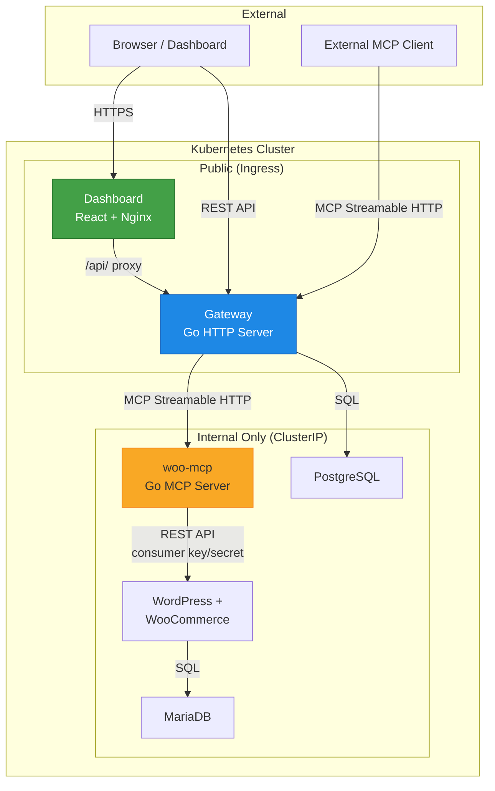

# Tollbooth – Design Document

## 1. Architecture Overview



### Component Responsibilities

| Component | Role | Exposure |
|-----------|------|----------|
| **Gateway** | MCP client to upstreams, MCP server to consumers, REST API for dashboard, auth, audit logging | Ingress (public) |
| **woo-mcp** | MCP server exposing WooCommerce data as tools via Streamable HTTP | ClusterIP (internal only) |
| **Dashboard** | React SPA for admins/members: server management, tool browsing, chat agent, audit logs | Ingress (public) |
| **WordPress + WooCommerce** | The e-commerce store | ClusterIP (internal only) |
| **MariaDB** | WordPress/WooCommerce database | ClusterIP (internal only) |
| **PostgreSQL** | Gateway state: users, API keys, upstream configs, audit logs | ClusterIP (internal only) |

---

## 2. Tool Aggregation and Routing

### Naming Scheme: `<server_slug>__<tool_name>`

When the gateway lists tools from multiple upstream MCP servers, tool names can collide (e.g., two servers both expose `list_products`). We resolve this with a **mandatory prefix scheme**:

```
woo_store1__list_products
woo_store1__get_order
inventory__list_products
```

**Rules:**
1. The double-underscore `__` is the separator. It is forbidden in both slugs and tool names.
2. Server slugs are user-defined when registering an upstream, validated against: `^[a-z][a-z0-9_]{0,62}$` (lowercase, starts with letter, max 63 chars, single underscores only).
3. Tool names from upstreams are passed through as-is after validation: `^[a-zA-Z][a-zA-Z0-9_]{0,126}$`.
4. If a slug collides with an existing registered server, registration is rejected with HTTP 409.
5. Tool descriptions from upstreams are prefixed with `[server_slug] ` so the LLM can distinguish context.

### Slug collision handling

- Slugs are unique per gateway instance (enforced by a UNIQUE constraint in PostgreSQL).
- Attempting to register a slug that already exists returns `409 Conflict`.
- Renaming a slug is an atomic operation (UPDATE + tool cache invalidation).

### Illegal characters

- If a tool name from an upstream contains `__`, the gateway rejects the tool during discovery and logs a warning. The remaining tools from that upstream are still registered.
- If a tool name contains characters outside `[a-zA-Z0-9_]`, those characters are stripped and a warning is logged. If the resulting name is empty or collides, the tool is skipped.

---

## 3. Failure Handling

### Per-upstream timeouts

Every MCP client call to an upstream has a **configurable per-server timeout** (default: 30s). This is enforced with `context.WithTimeout` so a slow upstream cannot block the gateway's HTTP handler goroutine indefinitely.

### Server health states

Each upstream is tracked with one of three states:

| State | Meaning | Behaviour |
|-------|---------|-----------|
| **Connected** | Last health check / tool call succeeded | Tools listed normally |
| **Unreachable** | Last N consecutive calls failed (default N=3) | Tools still listed but marked with `status: unreachable`; calls attempted but with shorter timeout |
| **Disabled** | Admin manually disabled the server | Tools hidden from listings; calls rejected immediately |

State transitions are recorded in the `mcp_servers` table (`status`, `last_error`, `last_checked_at`).

### Partial listing behaviour

- `GET /api/tools` always returns **all tools from all Connected and Unreachable servers**. Each tool includes the server's current status.
- If one upstream times out during a `tools/list` refresh, the gateway returns **stale cached tools** for that upstream and includes a `"stale": true` flag.
- If an upstream has never been reachable, it returns zero tools for that server (not an error at the API level).
- Tool calls to an Unreachable server are attempted (the state might be transient) but with a reduced timeout (default: 10s vs 30s).

### Circuit breaker (future)

We may add a circuit breaker pattern in a later chunk. For now, the N-consecutive-failures model is sufficient for the project scope.

---

## 4. WooCommerce Integration Approach

### Decision: WooCommerce REST API with consumer key/secret

**Alternatives considered:**

| Approach | Pros | Cons |
|----------|------|------|
| **REST API** ✅ | Official, stable, well-documented, works over HTTP, no filesystem access needed | Requires consumer key/secret, rate limits on large stores |
| WP-CLI | Direct, powerful | Requires exec into the WordPress container or a sidecar, brittle coupling |
| Direct DB queries | Fastest | Bypasses WooCommerce hooks/validation, schema is undocumented and changes between versions |

**Justification:** The REST API is the only approach that works without filesystem or process-level access to the WordPress pod. It is the officially supported integration path, has versioned endpoints (v3), and consumer key/secret auth is designed exactly for server-to-server use. The woo-mcp server stores credentials via Kubernetes Secrets and never exposes them beyond the pod.

### Credential flow

```
Kubernetes Secret (woo-consumer-key, woo-consumer-secret)
    → mounted as env vars in woo-mcp pod
    → used in Authorization header to WooCommerce REST API
    → never forwarded to gateway or browser
```

---

## 5. Authentication and Authorization

### Two auth surfaces

1. **Dashboard login (humans):** Session-based auth with HTTP-only cookies. Users log in with email + password. Passwords are hashed with bcrypt (cost=12). Sessions are stored in PostgreSQL with a TTL.

2. **Gateway API keys (programmatic):** For external MCP clients and the chat agent. API keys follow the format:

   ```
   tb_<prefix>_<random>
   ```

   - `tb_` identifies it as a Tollbooth key.
   - `<prefix>` is a random 8-character hex string stored in plaintext for **lookup** (like a username).
   - `<random>` is 32 bytes of `crypto/rand` output, base64url-encoded. This part is **hashed with SHA-256** before storage.
   - On authentication: extract prefix → query DB → hash the provided key → compare with stored hash.

   **Why SHA-256 and not bcrypt for API keys?** API keys are high-entropy random strings (not human-chosen passwords), so brute-force is infeasible. SHA-256 is O(1) per check vs bcrypt's intentional slowness, which matters for every API call.

### Key revocation

- Keys have a `revoked_at` timestamp. Setting it immediately invalidates the key.
- The `last_used_at` column helps admins identify stale keys.
- Revoked keys are soft-deleted (kept for audit trail) and periodically purged.

### Roles

| Role | Capabilities |
|------|-------------|
| **admin** | Full access: manage users, manage servers, manage API keys, view all audit logs, use chat |
| **member** | Use chat, view tools, view own audit logs, manage own API keys |

### Chat agent auth

The chat agent in the dashboard calls tools through the gateway **as the logged-in user**. The dashboard backend issues a short-lived (5 min) API key scoped to the user's session and role. This key is used for the MCP connection and never exposed to the browser — the dashboard backend proxies tool calls.

---

## 6. Credential Handling for Upstream Secrets

### Storage

Upstream MCP server credentials (e.g., WooCommerce consumer keys) are stored in the `mcp_servers` table in PostgreSQL.

### Encryption at rest

Credentials are encrypted before storage using AES-256-GCM:

1. A 256-bit **data encryption key (DEK)** is generated per credential and stored alongside the ciphertext.
2. The DEK itself is encrypted with a **key encryption key (KEK)** that lives in a Kubernetes Secret (`tollbooth-kek`).
3. This is envelope encryption: rotating the KEK only requires re-encrypting the DEKs, not all credentials.

```
KEK (in K8s Secret) → encrypts → DEK (in PostgreSQL alongside ciphertext) → encrypts → credential
```

### Access control

- Upstream credentials are **never** sent to the browser or to MCP clients.
- The gateway decrypts credentials only in-memory, only when establishing a connection to an upstream.
- The `GET /api/servers` endpoint returns server metadata but **never** the credential field.

---

## 7. Local Domain Approach

### Local (kind)

We use `*.localtest.me` which resolves to `127.0.0.1` without any `/etc/hosts` editing:

- `dashboard.localtest.me` → Dashboard
- `api.localtest.me` → Gateway
- `store.localtest.me` → WordPress (for admin access during setup)

The kind cluster maps host ports 80/443 to the ingress controller, and Ingress resources route by hostname.

### Production (k3s on VPS)

- Real domains with DNS A records pointing to the VPS IP.
- cert-manager with Let's Encrypt for TLS.
- Traefik (k3s default) or NGINX Ingress Controller.
- Values are swapped via `values-prod.yaml`.

---

## 8. Kubernetes Layout

### Namespaces

| Namespace | Contents |
|-----------|----------|
| `tollbooth` | All application workloads (gateway, woo-mcp, dashboard, WordPress, MariaDB, PostgreSQL) |
| `ingress-nginx` | Ingress controller (managed separately) |

Single namespace simplifies RBAC and service discovery for this project scope. Services reference each other by short DNS names (e.g., `gateway`, `postgres`).

### Secrets

| Secret Name | Namespace | Contents |
|-------------|-----------|----------|
| `postgres-credentials` | tollbooth | `POSTGRES_USER`, `POSTGRES_PASSWORD`, `POSTGRES_DB` |
| `mariadb-credentials` | tollbooth | `MYSQL_ROOT_PASSWORD`, `MYSQL_USER`, `MYSQL_PASSWORD`, `MYSQL_DATABASE` |
| `woo-credentials` | tollbooth | `WOO_CONSUMER_KEY`, `WOO_CONSUMER_SECRET` |
| `tollbooth-kek` | tollbooth | `KEK` (256-bit key for envelope encryption) |
| `gateway-session-secret` | tollbooth | `SESSION_SECRET` (for cookie signing) |

All secrets are created via `helm install --set` or `kubectl create secret` — never committed to the repo.

### PVCs

| PVC | Size (local/prod) | Used by |
|-----|-------------------|---------|
| `postgres-data` | 1Gi / 10Gi | PostgreSQL |
| `mariadb-data` | 1Gi / 10Gi | MariaDB |
| `wp-content` | 1Gi / 5Gi | WordPress (plugins, uploads) |

### Services and exposure

| Service | Type | Port | Accessible from |
|---------|------|------|-----------------|
| `gateway` | ClusterIP | 8080 | Ingress, other pods |
| `dashboard` | ClusterIP | 8080 | Ingress |
| `woo-mcp` | ClusterIP | 8081 | Gateway pod only |
| `wordpress` | ClusterIP | 80 | woo-mcp, Ingress (local only for setup) |
| `mariadb` | ClusterIP | 3306 | WordPress pod only |
| `postgres` | ClusterIP | 5432 | Gateway pod only |

### NetworkPolicy (planned for Chunk 2+)

```
woo-mcp:    ingress only from gateway
mariadb:    ingress only from wordpress
postgres:   ingress only from gateway
wordpress:  ingress only from woo-mcp and ingress-nginx
```

---

## Open Questions

1. **Session store:** Should we use PostgreSQL for session storage or switch to Redis? PostgreSQL is simpler (fewer moving parts) but Redis handles TTL natively. Current decision: PostgreSQL, revisit if session volume becomes a concern.

2. **Multi-tenancy:** The current design has one gateway instance managing multiple upstream servers. If we need per-team isolation, we'd need to shard by namespace or add tenant IDs. Current decision: single-tenant, note in THREAT_MODEL.md.

3. **Rate limiting:** Not currently planned. Should we add per-user rate limits on tool calls? Defer to a later chunk if needed.

4. **Webhook support:** WooCommerce supports webhooks for real-time updates. Should woo-mcp expose a webhook receiver so tools can return fresher data? Defer to post-MVP.

5. **Key rotation automation:** The KEK rotation process is manual (re-encrypt DEKs). Should we automate this with a CronJob? Defer.
