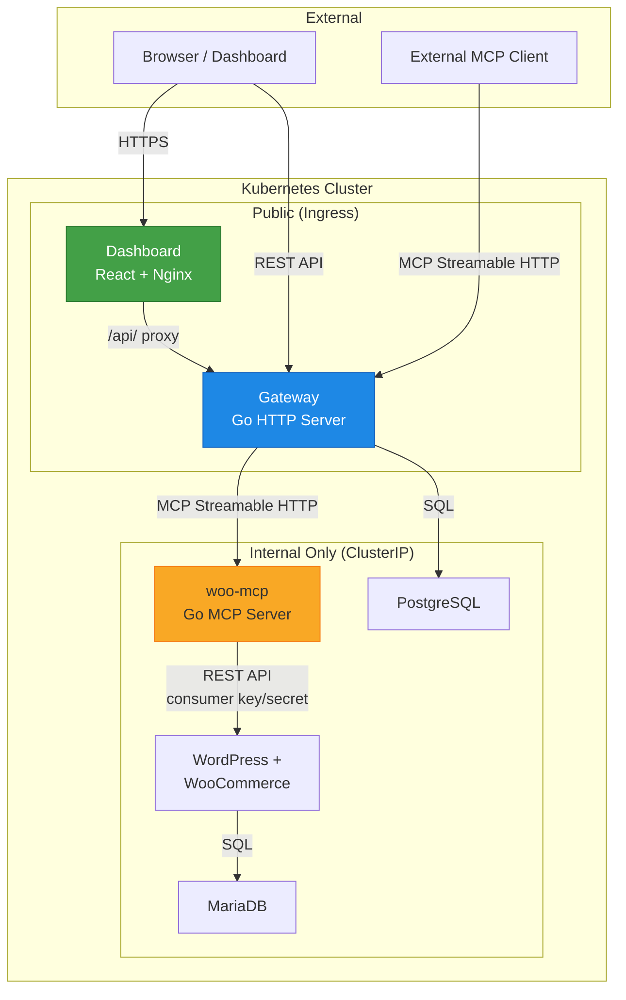

# Tollbooth – Design Document

## 1. Architecture Overview



### Component Responsibilities

| Component | Role | Exposure |
|-----------|------|----------|
| **Gateway** | MCP client to upstreams, MCP server to consumers, REST API for dashboard, auth, audit logging | Ingress (public) |
| **woo-mcp** | MCP server exposing WooCommerce data as tools via Streamable HTTP | ClusterIP (internal only) |
| **Dashboard** | React SPA for admins/members: server management, tool browsing, chat agent, audit logs | Ingress (public) |
| **WordPress + WooCommerce** | The e-commerce store | ClusterIP (internal only) |
| **MariaDB** | WordPress/WooCommerce database | ClusterIP (internal only) |
| **PostgreSQL** | Gateway state: users, API keys, upstream configs, audit logs | ClusterIP (internal only) |

---

## 2. Tool Aggregation and Routing

### Naming Scheme: `<server_slug>__<tool_name>`

When the gateway lists tools from multiple upstream MCP servers, tool names can collide (e.g., two servers both expose `list_products`). We resolve this with a **mandatory prefix scheme**:

```
woo_store1__list_products
woo_store1__get_order
inventory__list_products
```

**Rules:**
1. The double-underscore `__` is the separator. It is forbidden in both slugs and tool names.
2. Server slugs are user-defined when registering an upstream, validated against: `^[a-z][a-z0-9_]{0,62}$` (lowercase, starts with letter, max 63 chars, single underscores only).
3. Tool names from upstreams are passed through as-is after validation: `^[a-zA-Z][a-zA-Z0-9_]{0,126}$`.
4. If a slug collides with an existing registered server, registration is rejected with HTTP 409.
5. Tool descriptions from upstreams are prefixed with `[server_slug] ` so the LLM can distinguish context.

### Slug collision handling

- Slugs are unique per gateway instance (enforced by a UNIQUE constraint in PostgreSQL).
- Attempting to register a slug that already exists returns `409 Conflict`.
- Renaming a slug is an atomic operation (UPDATE + tool cache invalidation).

### Illegal characters

- If a tool name from an upstream contains `__`, the gateway rejects the tool during discovery and logs a warning. The remaining tools from that upstream are still registered.
- If a tool name contains characters outside `[a-zA-Z0-9_]`, those characters are stripped and a warning is logged. If the resulting name is empty or collides, the tool is skipped.

---

## 3. Failure Handling

### Per-upstream timeouts

Every MCP client call to an upstream has a **configurable per-server timeout** (default: 30s). This is enforced with `context.WithTimeout` so a slow upstream cannot block the gateway's HTTP handler goroutine indefinitely.

### Server health states

Each upstream is tracked with one of three states:

| State | Meaning | Behaviour |
|-------|---------|-----------|
| **Connected** | Last health check / tool call succeeded | Tools listed normally |
| **Unreachable** | Last N consecutive calls failed (default N=3) | Tools still listed but marked with `status: unreachable`; calls attempted but with shorter timeout |
| **Disabled** | Admin manually disabled the server | Tools hidden from listings; calls rejected immediately |

State transitions are recorded in the `mcp_servers` table (`status`, `last_error`, `last_checked_at`).

### Partial listing behaviour

- `GET /api/tools` always returns **all tools from all Connected and Unreachable servers**. Each tool includes the server's current status.
- If one upstream times out during a `tools/list` refresh, the gateway returns **stale cached tools** for that upstream and includes a `"stale": true` flag.
- If an upstream has never been reachable, it returns zero tools for that server (not an error at the API level).
- Tool calls to an Unreachable server are attempted (the state might be transient) but with a reduced timeout (default: 10s vs 30s).

### Circuit breaker (future)

We may add a circuit breaker pattern in a later chunk. For now, the N-consecutive-failures model is sufficient for the project scope.

---

## 4. WooCommerce Integration Approach

### Decision: WooCommerce REST API with consumer key/secret

**Alternatives considered:**

| Approach | Pros | Cons |
|----------|------|------|
| **REST API** ✅ | Official, stable, well-documented, works over HTTP, no filesystem access needed | Requires consumer key/secret, rate limits on large stores |
| WP-CLI | Direct, powerful | Requires exec into the WordPress container or a sidecar, brittle coupling |
| Direct DB queries | Fastest | Bypasses WooCommerce hooks/validation, schema is undocumented and changes between versions |

**Justification:** The REST API is the only approach that works without filesystem or process-level access to the WordPress pod. It is the officially supported integration path, has versioned endpoints (v3), and consumer key/secret auth is designed exactly for server-to-server use. The woo-mcp server stores credentials via Kubernetes Secrets and never exposes them beyond the pod.

### Credential flow

```
Kubernetes Secret (woo-consumer-key, woo-consumer-secret)
    → mounted as env vars in woo-mcp pod
    → used in Authorization header to WooCommerce REST API
    → never forwarded to gateway or browser
```

---

## 5. Authentication and Authorization

### Two auth surfaces

1. **Dashboard login (humans):** Session-based auth with HTTP-only cookies. Users log in with email + password. Passwords are hashed with bcrypt (cost=12). Sessions are stored in PostgreSQL with a TTL.

2. **Gateway API keys (programmatic):** For external MCP clients and the chat agent. API keys follow the format:

   ```
   tb_<prefix>_<random>
   ```

   - `tb_` identifies it as a Tollbooth key.
   - `<prefix>` is a random 8-character hex string stored in plaintext for **lookup** (like a username).
   - `<random>` is 32 bytes of `crypto/rand` output, base64url-encoded. This part is **hashed with SHA-256** before storage.
   - On authentication: extract prefix → query DB → hash the provided key → compare with stored hash.

   **Why SHA-256 and not bcrypt for API keys?** API keys are high-entropy random strings (not human-chosen passwords), so brute-force is infeasible. SHA-256 is O(1) per check vs bcrypt's intentional slowness, which matters for every API call.

### Key revocation

- Keys have a `revoked_at` timestamp. Setting it immediately invalidates the key.
- The `last_used_at` column helps admins identify stale keys.
- Revoked keys are soft-deleted (kept for audit trail) and periodically purged.

### Roles

| Role | Capabilities |
|------|-------------|
| **admin** | Full access: manage users, manage servers, manage API keys, view all audit logs, use chat |
| **member** | Use chat, view tools, view own audit logs, manage own API keys |

### Chat agent auth

The chat agent in the dashboard calls tools through the gateway **as the logged-in user**. The dashboard backend issues a short-lived (5 min) API key scoped to the user's session and role. This key is used for the MCP connection and never exposed to the browser — the dashboard backend proxies tool calls.

---

## 6. Credential Handling for Upstream Secrets

### Storage

Upstream MCP server credentials (e.g., WooCommerce consumer keys) are stored in the `mcp_servers` table in PostgreSQL.

### Encryption at rest

Credentials are encrypted before storage using AES-256-GCM:

1. A 256-bit **data encryption key (DEK)** is generated per credential and stored alongside the ciphertext.
2. The DEK itself is encrypted with a **key encryption key (KEK)** that lives in a Kubernetes Secret (`tollbooth-kek`).
3. This is envelope encryption: rotating the KEK only requires re-encrypting the DEKs, not all credentials.

```
KEK (in K8s Secret) → encrypts → DEK (in PostgreSQL alongside ciphertext) → encrypts → credential
```

### Access control

- Upstream credentials are **never** sent to the browser or to MCP clients.
- The gateway decrypts credentials only in-memory, only when establishing a connection to an upstream.
- The `GET /api/servers` endpoint returns server metadata but **never** the credential field.

---

## 7. Cluster Bootstrap, Networking and NetworkPolicy

### CNI Selection: KinD kindnet vs. Calico/Cilium
In KinD v0.25, `kindnetd` implements native Kubernetes `NetworkPolicy` enforcement using kernel packet filtering (nftables/iptables). We opted to use native `kindnet` rather than disabling default CNI to install Calico or Cilium:
- **Calico/Cilium Overhead:** Installing Calico in local dev KinD containers requires daemonsets (Felix, BIRD, Typha) consuming 500MB+ RAM per node and often causes startup race conditions during container node initialization.
- **kindnet Stability:** KinD v0.25's kindnet natively enforces Layer 3/4 network policies with near-zero overhead.
- **Empirical Proof:** Verified via `deploy/scripts/test-netpol.sh`. The test establishes a throwaway namespace with a default-deny ingress policy, confirms traffic from an unauthorized curl pod is actively dropped (exit code 28: connection timeout), applies an ingress allow policy for labeled pods, and confirms immediate HTTP 200 connectivity.

### Ingress & Local Domain Approach
Local ingress uses wildcard DNS `*.127.0.0.1.nip.io` (or `localtest.me`), mapping directly to `127.0.0.1` without local `/etc/hosts` modifications:
- `dashboard.127.0.0.1.nip.io` → React Dashboard
- `api.127.0.0.1.nip.io` → Gateway REST API & MCP endpoint
- `store.127.0.0.1.nip.io` → WordPress Storefront & Admin

For offline demonstrations, add the following to `/etc/hosts`:
```
127.0.0.1 store.127.0.0.1.nip.io dashboard.127.0.0.1.nip.io api.127.0.0.1.nip.io
```

### Local Image Loading in KinD
Custom images built on the host (`docker build`) can be loaded directly into KinD nodes using `kind load docker-image <image:tag> --name tollbooth`. All Helm workloads declare `imagePullPolicy: IfNotPresent`, ensuring cached local images are used without network roundtrips, while standard upstream images (`wordpress`, `mariadb`, `postgres`) are pulled automatically if not cached.

---

## 8. Store Layer Architecture (WordPress + WooCommerce + MariaDB)

### Workload Specifications
- **MariaDB:** Deployed as a `StatefulSet` with `volumeClaimTemplates` to ensure persistent storage semantics. Uses official `mariadb:11.4` (LTS). Health probes execute `/usr/local/bin/healthcheck.sh --connect --innodb_initialized`.
- **WordPress:** Deployed as a `Deployment` with a persistent volume claim mounted at `/var/www/html/wp-content`. Uses official `wordpress:6.7-php8.2-apache`. Health probes query `/wp-login.php`.
- **Ingress Isolation:** Only the WordPress storefront/admin (`store.127.0.0.1.nip.io`) is exposed via Ingress. MariaDB is strictly exposed via a `ClusterIP` service on port 3306, inaccessible from outside the cluster.

### Security Contexts & Privilege Justification
- **MariaDB:** Runs fully unprivileged with `securityContext`: `runAsNonRoot: true`, `runAsUser: 999`, `fsGroup: 999`.
- **WordPress:** Runs Apache as root initially because the Linux kernel requires root privileges (`CAP_NET_BIND_SERVICE`) to bind standard HTTP port 80 and initialize log files in `/var/log/apache2`. Once started, Apache immediately drops privileges to the unprivileged `www-data` user (UID 33) for all worker processes handling incoming HTTP requests.
- **Bootstrap Job:** Runs as `runAsUser: 0` because it executes administrative WP-CLI operations and must run `chown -R 33:33 /var/www/html/wp-content` on the persistent volume so the unprivileged Apache `www-data` worker processes can write uploaded media and plugin assets.

### Persistent Volumes & Pod Scheduling (RWO Multi-Node Affinity)
Kubernetes `ReadWriteOnce` (RWO) persistent volumes can only be attached to a single cluster node at any given time. If the WordPress web pod and the Bootstrap Job pod were scheduled onto different nodes in a multi-node cluster, the Job pod would fail during volume attachment with a `Multi-Attach error for volume`.
To eliminate this risk, the Bootstrap Job (`job-bootstrap.yaml`) defines explicit `podAffinity`:
```yaml
affinity:
  podAffinity:
    requiredDuringSchedulingIgnoredDuringExecution:
      - labelSelector:
          matchLabels:
            app.kubernetes.io/name: wordpress
            app.kubernetes.io/instance: {{ .Release.Name }}
            app.kubernetes.io/component: store
        topologyKey: "kubernetes.io/hostname"
```
This guarantees that Kubernetes schedules the Bootstrap Job on the exact same node (`kubernetes.io/hostname`) hosting the active WordPress pod, allowing both pods to access the shared RWO volume without volume attachment conflicts.

### NetworkPolicy Matching for Bootstrap Job
The MariaDB NetworkPolicy podSelector matches pods with labels:
```yaml
matchLabels:
  app.kubernetes.io/name: wordpress
  app.kubernetes.io/instance: {{ .Release.Name }}
```
By omitting `app.kubernetes.io/component: store`, this rule intentionally matches both the WordPress web deployment (`component: store`) and the Bootstrap Job (`component: bootstrap`), granting the temporary bootstrap runner direct MySQL connectivity on port 3306 while blocking all other cluster traffic.

---

## 9. WooCommerce REST API Authentication & Key Storage

### How WooCommerce Hashes and Stores API Keys
WooCommerce does not store consumer keys in plaintext. Inspecting `includes/wc-core-functions.php` and `includes/class-wc-rest-authentication.php` reveals the exact hashing implementation:
```php
function wc_api_hash( $data ) {
    return hash_hmac( 'sha256', $data, 'wc-api' );
}
```
When an API key is generated:
1. `consumer_key` is generated (prefixed `ck_...`).
2. `consumer_secret` is generated (prefixed `cs_...`).
3. The row is inserted into `wp_woocommerce_api_keys`:
   - `consumer_key`: The 64-character hex string of `hash_hmac('sha256', $consumer_key, 'wc-api')`.
   - `consumer_secret`: Stored in plaintext (prefixed `cs_...`).
   - `truncated_key`: The last 7 characters of `$consumer_key`.
   - `permissions`: `'read_write'`.
   - `user_id`: Tied to a dedicated shop-manager user (`shop_manager`).

### In-Cluster HTTP Authentication: The `is_ssl()` Requirement
In WooCommerce core (`class-wc-rest-authentication.php`):
```php
public function authenticate( $user_id ) {
    if ( ! empty( $user_id ) || ! $this->is_request_to_rest_api() ) {
        return $user_id;
    }
    if ( is_ssl() ) {
        $user_id = $this->perform_basic_authentication();
    }
    if ( $user_id ) {
        return $user_id;
    }
    return $this->perform_oauth_authentication();
}
```
- **The Problem:** Over plain HTTP (such as internal Kubernetes ClusterIP communication `http://store-wordpress:80/wp-json/wc/v3/...`), `is_ssl()` evaluates to `false`. When `is_ssl()` is false, WooCommerce **refuses** to evaluate Basic Authentication headers or query parameters, failing with `401 Unauthorized` (`woocommerce_rest_cannot_view: Sorry, you cannot list resources`) and falling back to OAuth 1.0a signature verification.
- **The Solution:** Our WordPress deployment sets `WORDPRESS_CONFIG_EXTRA` in `wp-config.php`:
  ```php
  if (isset($_SERVER['HTTP_X_FORWARDED_PROTO']) && $_SERVER['HTTP_X_FORWARDED_PROTO'] === 'https') {
      $_SERVER['HTTPS'] = 'on';
  }
  ```
- **How woo-mcp Talks to the Store:** When `woo-mcp` calls the WooCommerce REST API, it sends:
  1. Standard HTTP Basic Auth: `Authorization: Basic base64(consumer_key:consumer_secret)`
  2. Header: `X-Forwarded-Proto: https`
  This satisfies `is_ssl()` within WordPress, allowing clean, fast, header-based authentication without OAuth 1.0a signing overhead.

---

## 10. Kubernetes Layout

### Namespaces

| Namespace | Contents |
|-----------|----------|
| `tollbooth` | All application workloads (gateway, woo-mcp, dashboard, WordPress, MariaDB, PostgreSQL) |
| `ingress-nginx` | Ingress controller (managed separately) |

Single namespace simplifies RBAC and service discovery for this project scope. Services reference each other by short DNS names (e.g., `gateway`, `postgres`).

### Secrets

| Secret Name | Namespace | Contents |
|-------------|-----------|----------|
| `postgres-credentials` | tollbooth | `POSTGRES_USER`, `POSTGRES_PASSWORD`, `POSTGRES_DB` |
| `mariadb-credentials` | tollbooth | `MYSQL_ROOT_PASSWORD`, `MYSQL_USER`, `MYSQL_PASSWORD`, `MYSQL_DATABASE` |
| `wordpress-admin-credentials` | tollbooth | `ADMIN_USER`, `ADMIN_PASSWORD`, `ADMIN_EMAIL` |
| `woocommerce-api-keys` | tollbooth | `CONSUMER_KEY`, `CONSUMER_SECRET` |
| `woo-mcp-auth` | tollbooth | `MCP_AUTH_TOKEN` (static Bearer token for woo-mcp) |
| `tollbooth-kek` | tollbooth | `KEK` (256-bit key for envelope encryption) |
| `gateway-session-secret` | tollbooth | `SESSION_SECRET` (for cookie signing) |

All secrets are created via `deploy/scripts/create-secrets.sh` or `helm install --set` — never committed to the repository.

### PVCs

| PVC | Size (local/prod) | Used by |
|-----|-------------------|---------|
| `postgres-data` | 1Gi / 10Gi | PostgreSQL |
| `mariadb-data` | 1Gi / 10Gi | MariaDB |
| `wp-content` | 1Gi / 5Gi | WordPress (plugins, uploads) |

### Services and exposure

| Service | Type | Port | Accessible from |
|---------|------|------|-----------------|
| `gateway` | ClusterIP | 8080 | Ingress, other pods |
| `dashboard` | ClusterIP | 8080 | Ingress |
| `woo-mcp` | ClusterIP | 8081 | Gateway pod only (enforced by NetworkPolicy) |
| `wordpress` | ClusterIP | 80 | woo-mcp, Ingress (storefront) |
| `mariadb` | ClusterIP | 3306 | WordPress pod only (enforced by NetworkPolicy) |
| `postgres` | ClusterIP | 5432 | Gateway pod only |

### NetworkPolicy Implementation (Active)

1. **`woo-mcp-netpol` (`charts/woo-mcp`):**
   - **Ingress:** Allows TCP 8081 ONLY from pods with label `app.kubernetes.io/name: gateway`.
   - **Egress:** Allows DNS (UDP/TCP 53) to `kube-dns` in `kube-system`, and HTTP (TCP 80) ONLY to `app.kubernetes.io/name: wordpress`, `component: store`.
2. **`wordpress-netpol` (`charts/store`):**
   - **Ingress:** Allows TCP 80 from ingress controller (`ingress-nginx` namespace) and `app.kubernetes.io/name: woo-mcp`.
3. **`mariadb-netpol` (`charts/store`):**
   - **Ingress:** Allows TCP 3306 ONLY from `app.kubernetes.io/name: wordpress` (web store and bootstrap Job).

---

## 11. woo-mcp Upstream Service Architecture & Implementation

### SDK Choice
The `woo-mcp` service is built with the official Anthropic Model Context Protocol Go SDK:
```
github.com/modelcontextprotocol/go-sdk v1.8.0
```
This SDK provides native typed tool definitions, JSON schema generation from Go structs (`jsonschema-go`), and compliant Streamable HTTP transport handlers.

### Stateless Streamable HTTP Transport
`woo-mcp` is exposed over Streamable HTTP (`/mcp`) using stateless mode:
```go
mcpStreamable := mcp.NewStreamableHTTPHandler(func(_ *http.Request) *mcp.Server {
    return mcpServer
}, &mcp.StreamableHTTPOptions{
    Stateless:                  true,
    DisableLocalhostProtection: true,
})
```
**Why Stateless?**
- Eliminates in-memory session maps that would break on pod restarts or during rolling deployments.
- Allows any replica behind the `ClusterIP` Service to handle any request without sticky sessions or session replication.
- Enables simple, reliable integration for HTTP clients (like the Gateway) using standard JSON-RPC 2.0 over HTTP POST.

### Authentication
Incoming requests to `/mcp` require Bearer authentication:
```
Authorization: Bearer <MCP_AUTH_TOKEN>
```
The token is validated in `BearerAuthMiddleware` using `crypto/subtle.ConstantTimeCompare` against the value supplied via `MCP_AUTH_TOKEN` environment variable (mounted from Secret `woo-mcp-auth`). Unauthenticated or invalid requests immediately return `401 Unauthorized` with `Www-Authenticate: Bearer realm="woo-mcp"`.

### Tool Inventory & Honest Annotations

| Tool Name | Title | Description | Annotations |
|-----------|-------|-------------|-------------|
| `list_products` | List Products | List products from the WooCommerce catalog with search keyword and pagination filters. | `readOnlyHint: true`, `destructiveHint: false`, `idempotentHint: true` |
| `get_product` | Get Product | Retrieve detailed information for a single WooCommerce product by unique ID. | `readOnlyHint: true`, `destructiveHint: false`, `idempotentHint: true` |
| `create_product` | Create Product | Create a new simple product in the WooCommerce catalog with name and decimal price. | `readOnlyHint: false`, `destructiveHint: false`, `idempotentHint: false` |
| `list_orders` | List Orders | List orders with optional status, date range (ISO 8601 UTC), and pagination filters. | `readOnlyHint: true`, `destructiveHint: false`, `idempotentHint: true` |
| `get_order` | Get Order | Retrieve details of a specific WooCommerce order by ID, line items, and customer name/email. | `readOnlyHint: true`, `destructiveHint: false`, `idempotentHint: true` |
| `update_order_status` | Update Order Status | Update the status of an existing WooCommerce order. | `readOnlyHint: false`, `destructiveHint: false`, `idempotentHint: true` |

### PII Protection & Data Sanitization
1. **`list_orders` PII Exclusion:** Order listings return only operational metadata (`id`, `status`, `total`, `currency`, `date_created`, `payment_method_title`, `line_items`). All customer contact data (name, email, phone number, shipping/billing address) is completely excluded from list responses.
2. **`get_order` Minimization:** Full order details return only customer name (`first_name`, `last_name`) and `email` for verification purposes. Phone numbers, street addresses, postal codes, and payment transaction tokens are stripped.
3. **HTML Sanitization:** Product descriptions returned to LLM consumers are stripped of HTML tags using regex sanitization to prevent markup injection or token wastage.

### Date & Time Handling
- WooCommerce stores order timestamps in UTC under HPOS `wp_wc_orders.date_created_gmt`.
- All date queries to the WooCommerce REST API include `dates_are_gmt=true` to ensure deterministic query semantics regardless of site timezone configuration.
- Flexible parsing accepts `RFC3339` (`2026-10-25T00:00:00Z`), ISO 8601 with offset, ISO without timezone, or date-only (`2006-01-02`).

### Error Mapping & Fault Tolerance
- **Business/API Errors:** When WooCommerce returns 4xx or 5xx HTTP status codes (e.g., 404 Not Found for missing product/order, 400 Bad Request), `woo-mcp` does NOT return transport-level errors or panic. Instead, it returns a valid MCP `CallToolResult` with `isError: true` and a human-readable message. This lets the LLM agent understand the problem and formulate an informative response.
- **Input Validation:** Parameter validation occurs before network dispatch (e.g., regex `^\d+(\.\d{1,2})?$` on prices, positive IDs, order status enum validation). Invalid parameters return `isError: true` with validation feedback immediately.
- **Probe Decoupling:** `/healthz` and `/readyz` probes report the status of the `woo-mcp` process itself. If the store goes down or restarts, `woo-mcp` remains Ready (`/readyz` returns 200) and gracefully returns `isError: true` on tool calls rather than crashing or causing Kubernetes restart cascades.

---

## 12. Gateway Core: Persistence, Registry, and Credential Security (Chunk 3 Part A)

### PostgreSQL StatefulSet & Data Persistence
- **Workload:** PostgreSQL 16 is deployed as a single-replica `StatefulSet` with dedicated `volumeClaimTemplates` (`postgres-data`, 1Gi local / 10Gi prod).
- **Probes:**
  - Liveness & Readiness: `pg_isready -U "$POSTGRES_USER" -d "$POSTGRES_DB"`.
- **Security:** Runs with non-root security context (`runAsUser: 999`, `fsGroup: 999`).
- **Network Isolation:** Ingress is strictly restricted via `postgres-netpol` to pods carrying `app.kubernetes.io/name: gateway` on TCP port 5432. All other pods (such as `woo-mcp` or `store-wordpress`) time out with exit code 28.

### Embedded Migrations with Advisory Locks
Database migrations are embedded into the Go binary (`//go:embed`) and executed at gateway startup via `db.Migrate`:
- **Advisory Lock:** Before schema checks or execution, the gateway acquires a PostgreSQL session-level advisory lock (`SELECT pg_advisory_lock(742910381923)`). This ensures atomic, safe migrations even when multiple gateway replicas start up concurrently.
- **Tracking:** A dedicated `schema_migrations` table records applied versions with timestamps.
- **Scope:** Creates `mcp_servers` and `mcp_tools` tables with foreign keys and cascade rules.

### AES-256-GCM Credential Security
- **Encryption Algorithm:** AES-256-GCM authenticated encryption.
- **Nonce Generation:** Every credential encryption operation generates a cryptographically secure, random 12-byte nonce (`crypto/rand`). Nonces are stored alongside ciphertext in `credential_nonce`.
- **Tamper Detection:** GCM Poly1305 authentication tags are validated during decryption; tampered ciphertexts or nonces fail decryption with clear errors.
- **Write-Only Principle:** Decrypted credentials exist in memory only during active upstream network calls. API responses, server models, and log messages **never** disclose credentials; responses only return `has_credential: true/false`.
- **Key Rotation Gap:** Currently, encryption uses a static 256-bit key from `gateway-encryption-key` Secret. Rekeying/rotation across existing database rows is a documented gap to be addressed in post-MVP tooling.

### Registry API & Validation
- **Endpoints:** Protected by `auth.Middleware` behind the `Authenticator` interface:
  - `POST /api/servers`: Register server with name, slug, URL, optional credential, timeout.
  - `GET /api/servers`: List all servers with `tool_count` and `has_credential`.
  - `GET /api/servers/{id}`: Retrieve server by UUID or slug.
  - `PUT /api/servers/{id}`: Update server configuration, URL, enabled status, or credential.
  - `DELETE /api/servers/{id}`: Remove server and cascade associated cached tools.
  - `POST /api/servers/{id}/test`: Test connectivity to upstream MCP server via JSON-RPC `initialize`.
- **Slug Validation:** Strictly matches `^[a-z0-9]([a-z0-9-]{0,18}[a-z0-9])?$` (1-20 characters, lowercase alphanumeric and hyphens, no underscores). This guarantees that splitting on the first `__` cleanly distinguishes the slug from the tool name.
- **URL Validation:** Rejects non-HTTP(S) schemes or malformed hosts. Duplicate slugs return `409 Conflict`.

### Temporary Authentication
Chunk 3 implements a `BootstrapAuthenticator` satisfying the `Authenticator` interface. It verifies incoming `Authorization: Bearer <token>` against the Secret `gateway-bootstrap-token` using `crypto/subtle.ConstantTimeCompare`. This provides immediate security while keeping auth pluggable for Chunk 4's multi-user sessions, roles, and hashed API keys.

### Idempotent Seeding
On startup, the gateway checks for the existence of the default `woo` server in `mcp_servers`. If missing, it registers `woo` pointing to `SEED_WOO_URL` with the Bearer token from `SEED_WOO_TOKEN`. If `woo` already exists, seeding skips execution to avoid overwriting admin edits.

### Ingress Streaming Configuration
The Gateway ingress at `gateway.127.0.0.1.nip.io` applies critical NGINX annotations:
```yaml
nginx.ingress.kubernetes.io/proxy-buffering: "off"
nginx.ingress.kubernetes.io/proxy-read-timeout: "3600"
nginx.ingress.kubernetes.io/proxy-send-timeout: "3600"
```
- **Why Proxy Buffering Off?** MCP uses Streamable HTTP / Server-Sent Events (SSE). Without `proxy-buffering: "off"`, NGINX buffers chunked responses until buffer thresholds are met or connections close, preventing real-time chunk streaming to LLM clients.
- **Why Long Timeouts?** Large tool calls or long streaming conversations can exceed standard proxy timeouts (60s). 3600-second timeouts ensure long-running queries or interactive sessions are not prematurely terminated by the proxy.

### NetworkPolicy & SSRF Considerations
- **Gateway NetworkPolicy:** Gateway egress is locked down to CoreDNS (`kube-dns:53`), PostgreSQL (`postgres:5432`), and `woo-mcp:8081`.
- **External Upstreams:** Admin-added external upstream servers require wider network egress, gated behind `networkPolicy.allowExternalEgress` in Helm values.
- **SSRF Deferred:** Validating and firewalling user-supplied upstream URLs against internal infrastructure (AWS metadata endpoints, cluster IP ranges) is recorded in `THREAT_MODEL.md` and deferred to the hardening chunk.

---

## Open Questions

1. **Session store:** Should we use PostgreSQL for session storage or switch to Redis? PostgreSQL is simpler (fewer moving parts) but Redis handles TTL natively. Current decision: PostgreSQL, revisit if session volume becomes a concern.

2. **Multi-tenancy:** The current design has one gateway instance managing multiple upstream servers. If we need per-team isolation, we'd need to shard by namespace or add tenant IDs. Current decision: single-tenant, note in THREAT_MODEL.md.

3. **Rate limiting:** Not currently planned. Should we add per-user rate limits on tool calls? Defer to a later chunk if needed.

4. **Webhook support:** WooCommerce supports webhooks for real-time updates. Should woo-mcp expose a webhook receiver so tools can return fresher data? Defer to post-MVP.

5. **Key rotation automation:** The KEK rotation process is manual (re-encrypt DEKs). Should we automate this with a CronJob? Defer.

